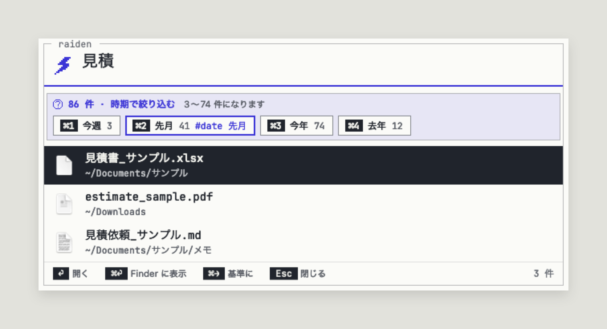
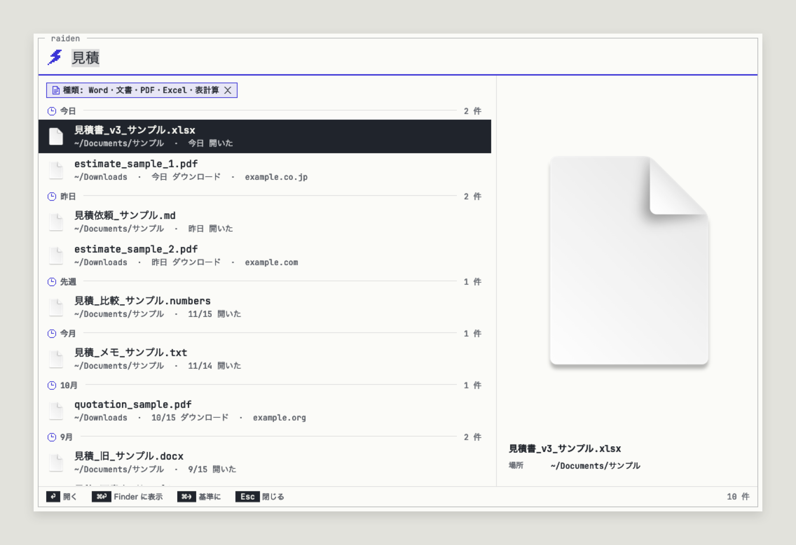
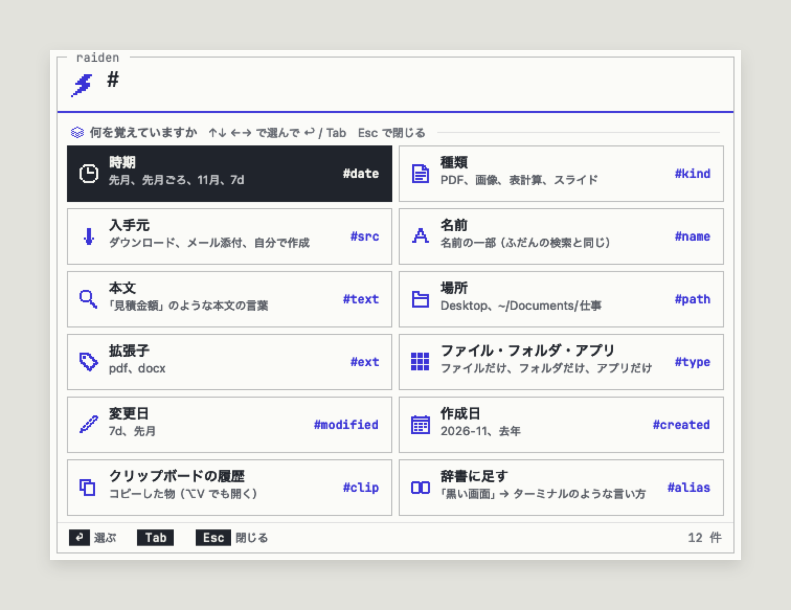

# Raiden

Mac のアプリとファイルを、覚えている手がかり（時期・種類・入手元・場所）と「#」の絞り込みで探して開くランチャー。



> 状態: 自分用に作っている途中です。macOS 15 以上が要り、Apple Silicon（arm64）向けにビルドします。

## できること

- **アプリとファイルを探す**: ⌥Space で画面の中央に入力欄が出ます。打つのが止まって 0.1 秒たつと、アプリと Mac 全体のファイル・フォルダから候補を出します。ファイルは Spotlight に問い合わせるので、自前の一覧は持ちません。
- **「#」で絞り込む**: `#kind pdf #date 先月 見積` のように、種類・時期・場所・入手元などの条件を足して確実に絞ります。「#」だけ打つと、使える条件が一覧で出ます。
- **思い出すのを手伝う**: 何も打っていないときは最近の作業のまとまりを出します。候補が多いときは「時期で絞り込む ⌘1 今週 …」のように絞り方を提案し、0 件のときは探し方の変え方を出します。見つけたファイルの行で ⌘→ を押すと、そのファイルと同じころに使った物や、同じプロジェクトの物を探せます。
- **言い方を覚える**: 選んで開いた「打った言葉 → 物」を覚えて、次から上に出します。「黒い画面 → ターミナル」のような自分の言い方は、辞書に足せます。
- **クリップボードの履歴**: ⌥V で、コピーした文字の履歴を出します。どのアプリでコピーし、どこに貼ったかも残ります。
- **プレビュー**: ファイルの行を選ぶと、窓の右に Quick Look のサムネイルと、入手元・最後に開いた日などを出します。

言語モデルや埋め込みは使いません。アプリは名前・辞書・選んだ記録の文字の一致で、ファイルは Spotlight の条件で探します。意味の近さで探す機能はありません。標準のアプリと一部のアプリには手書きの説明があり、打った言葉がその説明に当たれば出ます。



## 入れ方

Xcode は要りません。Command Line Tools だけでビルドします。

```sh
git clone https://github.com/k-aoshima/raiden.git
cd raiden
scripts/build.sh --install   # ~/Applications/Raiden.app に入れて起動
```

`scripts/build.sh` だけなら `build/Raiden.app` を作って止まります。メニューバーに常駐し、Dock には出ません。`~/Applications` から起動すると、ログイン時に起動するよう登録します（メニューバーの「ログイン時に起動」で切れます）。

初めて書類・デスクトップ・ダウンロードのファイルを探すときに、macOS がアクセスの許可を聞きます。ビルドのたびに許可を聞き直されるのを避けたいときは、キーチェーンに自己署名の証明書を作り、`scripts/build.sh` の `SIGN` の名前をその証明書に合わせてください。無ければアドホック署名になります。

## 使い方

| キー | すること |
|---|---|
| ⌥Space | 入力欄を開く（取れなければ ⌃⌥⌘Space。設定で変えられる） |
| ↑ ↓ | 候補を選ぶ |
| ↩ | 開く（フォルダは Finder で開く） |
| ⌘↩ | Finder に表示する |
| ⌥↩ | 今の言葉 → 選んだ物を辞書に足してから開く |
| ⌘→ | 選んだファイルを基準に探す（同じころに使った物・同じプロジェクト） |
| ⌘1〜⌘4 | 一覧の上の絞り込みの提案を選ぶ |
| Tab | 「#」の一覧や言葉からの候補を決める |
| ⌘S | 今の条件に名前を付けて保存する（`#仕事のPDF` で呼び出せる） |
| ⌘⌫ | 条件のチップを全部消す |
| Esc | 閉じる |
| ⌥V | クリップボードの履歴を開く |

### 「#」の条件



条件は入力の先頭か空白の後ろに書きます。全角の「＃」でも効きます。違う条件どうしは「かつ」、同じ条件を 2 回書くかカンマで区切ると「または」です。条件を抜いた残りの言葉で、名前を探します。

| 条件 | 別名 | 値の例 | 意味 |
|---|---|---|---|
| `#kind` | `#k` `#種類` | pdf, image, ss（スクショ）, movie, music, doc, xls, ppt, md, code, zip, folder, app | 種類 |
| `#type` | `#t` `#app` `#folder` `#file` | f, d, app | ファイル・フォルダ・アプリ |
| `#ext` | `#e` `#拡張子` | pdf, docx | 拡張子 |
| `#date` | `#日付` | 今日, 昨日, 先週, 先月, 7d, 2026-11, 11-14..11-16, 先月ごろ | 使った日・変更日・追加日・作成日のどれかが入る |
| `#modified` | `#m` `#変更日` | `#date` と同じ | 変更日 |
| `#created` | `#c` `#作成日` | `#date` と同じ | 作成日 |
| `#path` | `#p` `#in` `#場所` | Desktop, ~/Documents/仕事 | その場所の下 |
| `#name` | `#n` `#名前` | 請求 | 名前にその文字を含む |
| `#src` | `#source` `#入手元` | dl, mail, mine | ダウンロードした物・メール添付・自分で作った物 |
| `#text` | `#content` `#本文` `#中身` | 見積金額 | 本文にその言葉を含む（Spotlight の本文の索引） |
| `#with` | `#w` `#一緒` | ファイル 1 つ | そのファイルと同じころに使った物 |
| `#near` | `#nr` `#近く` | ファイルかフォルダ 1 つ | そのファイルと同じプロジェクトの物 |
| `#保存` | `#save` | 名前 | 今の条件に名前を付けて保存する |
| `#alias` | `#dict` `#辞書` | 言い方 | 言い方を辞書に足す |

「#」を打たなくても、「先週の pdf」と打つと `#date lastweek` や `#ext pdf` を薄く提案します。Tab で決めたときだけ絞ります。

## 設定

メニューバーの「設定…」（⌘,）で開きます。

- **除外**: Spotlight の結果から外すフォルダと名前（初期値は `~/Library`、`node_modules`、`build` など）
- **一般**: 入力欄を開くキー、候補の最大件数（初期値 9 件）、アプリとファイルの節の並び、外観（ライト・ダーク・Mac に合わせる）、プレビュー、クリップボードの履歴、ログイン時に起動
- **学習**: 選んだ結果を覚えるか、辞書、保存した条件、よく使う条件の組み合わせ、選んで開いた記録
- **記録**: 検索の記録を残すか、残す日数（初期値 90 日）、見つからなかった言い方

## データの置き場所

どのデータも手元の Mac にだけ置き、外へは送りません。

| 物 | 場所 |
|---|---|
| 設定・辞書・保存した条件 | `~/Library/Application Support/Raiden/settings.json` |
| 選んだ記録・検索の記録 | `~/Library/Application Support/Raiden/raiden.sqlite` |
| 動作の記録 | `~/Library/Logs/Raiden/raiden.log` |

## 開発

```sh
scripts/build.sh                    # build/Raiden.app と build/raiden-eval を作る
build/raiden-eval --test-filters    # 「#」の解析と候補の確かめ
build/Raiden.app/Contents/MacOS/Raiden --snapshot docs/ui   # 画面の見本を PNG に書き出す（RAIDEN_THEME=dark で暗い地）
```

この Mac の Command Line Tools では SwiftPM のリンクが通らないので、`swiftc` を直接呼んでいます。並べ方、Spotlight への問い合わせ、保存の形、答え合わせの結果は [docs/architecture.md](docs/architecture.md) にあります。

画面は [Kodou-ui](https://github.com/k-aoshima/kodou-ui) で作っています。色と決まりは [DESIGN.md](DESIGN.md) にあります。等幅の字体に [JetBrains Mono](https://www.jetbrains.com/lp/mono/)（SIL Open Font License 1.1）を同梱しています。
